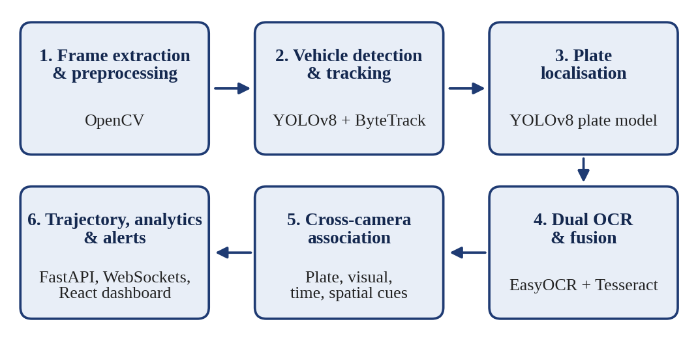

# Project Report
### On
## Vehicle Number Plate ANPR Detection and Multi-Camera Trajectory Tracking (NETRA)

**Course:** Statistical Machine Learning (CSET211)  
**Session:** 2026-27  

**Supervised by:**  
**Mrs. Shivanshi Shrivastava**  

**Submitted by:**  
| Name | Enrollment ID |
| :--- | :--- |
| **Kaustubh Chowdhury** | S25CSEU0210 |
| **Shivaji Bhushan** | S25CSEU0195 |
| **Atiksh Sharma** | S25CSEU0192 |

**B.Tech. (Computer Science and Engineering)**  
**School of Computer Science Engineering and Technology**  
**Bennett University**  
*Submission Date: 10 October 2026*

---

## Contents
- [Abstract](#abstract)
- [Chapter 1: Introduction to the Project](#chapter-1-introduction-to-the-project)
  - [1.1 Background](#11-background)
  - [1.2 Problem Statement](#12-problem-statement)
  - [1.3 Objectives of the Project](#13-objectives-of-the-project)
  - [1.4 Methodology Overview](#14-methodology-overview)
- [Chapter 2: Literature Review](#chapter-2-literature-review)
  - [2.1 Summary of Existing Work](#21-summary-of-existing-work)
  - [2.2 Key Theories and Models](#22-key-theories-and-models)
  - [2.3 Relevance to the Project](#23-relevance-to-the-project)
- [Chapter 3: Methodologies](#chapter-3-methodologies)
  - [3.1 Data Collection Methods](#31-data-collection-methods)
  - [3.2 Dataset Description](#32-dataset-description)
  - [3.3 Data Preprocessing](#33-data-preprocessing)
  - [3.4 Exploratory Data Analysis](#34-exploratory-data-analysis)
  - [3.5 Tools and Technologies Used](#35-tools-and-technologies-used)
  - [3.6 Implementation and Technical Progress](#36-implementation-and-technical-progress)
- [Chapter 4: Results and Discussion](#chapter-4-results-and-discussion)
- [Chapter 5: Conclusion and Future Work Plan](#chapter-5-conclusion-and-future-work-plan)
- [References](#references)

---

## Abstract

Manual monitoring of vehicles and manual reading of number plates are slow and error-prone, particularly in dense traffic where images suffer from blur, glare, different viewing angles and similar-looking plates. This project builds a software pipeline for automatic number plate recognition (ANPR) that can also follow a vehicle across several CCTV cameras and derive traffic analytics from the resulting sightings.

The objectives are to detect vehicles and number plates in video frames, read the registration number, link observations of the same vehicle across cameras, reconstruct its trajectory with travel times, and raise alerts. Publicly available datasets from Kaggle and Roboflow Universe were combined, giving roughly 80,000 vehicle images and 60,000 annotated plates. Frames were resized, normalised, annotated, augmented and split into training, validation and test sets. YOLOv8 detects vehicles and plates, ByteTrack tracks vehicles within a camera, and two OCR engines (EasyOCR and Tesseract) read each plate crop. Their outputs are fused using confidence scores and plate-format checks. Cross-camera matching uses plate similarity, visual similarity, timestamps and spatial context. The system is served through a FastAPI backend and a React dashboard with real-time WebSocket updates.

On the test set, vehicle detection accuracy was about 92%, OCR accuracy about 88%, and processing time about 150 ms per frame. The results show that the approach is workable for near real-time use. Multi-camera linking has not yet been measured on labelled data, so future work centres on that evaluation, on robustness in poor lighting, and on lower latency.

**Keywords:** `ANPR`, `YOLOv8`, `OCR`, `multi-camera tracking`, `trajectory reconstruction`, `traffic analytics`.

---

## Chapter 1: Introduction to the Project

### 1.1 Background
Urban areas face growing congestion, road accidents, emergency delays and loss of fuel and time. Traditional traffic monitoring is manual, slow and costly, so authorities cannot react quickly. Many cities already have CCTV cameras, and machine learning can turn this video into structured data about which vehicle was seen, where and when. A number plate is a unique public identifier, which makes ANPR the natural starting point.

### 1.2 Problem Statement
To develop a city-wide AI engine for multi-camera ANPR, trajectory tracking and urban traffic analytics. It must read plates under varied conditions, link the same vehicle across cameras, and give traffic managers useful analytics. The project emphasises model choice, learning from data and evaluation.

### 1.3 Objectives of the Project
1. Detect vehicles and recognise number plates from CCTV feeds.
2. Re-identify vehicles across multiple cameras.
3. Reconstruct vehicle trajectories and estimate travel times.
4. Provide traffic analytics and alerts for traffic management.

### 1.4 Methodology Overview
The pipeline is written in Python. OpenCV prepares frames, YOLOv8 detects vehicles and plates, ByteTrack tracks vehicles within one camera, and EasyOCR with Tesseract reads the plates. Observations are linked across cameras and stored for analytics. Training data comes from public Kaggle and Roboflow Universe datasets.

---

## Chapter 2: Literature Review

### 2.1 Summary of Existing Work
- **Detection:** Redmon et al. introduced YOLO, which treats detection as a single regression problem and runs in real time [1]; Ultralytics released YOLOv8 as a widely used implementation [2]. Laroca et al. built a real-time plate recognition system on a YOLO detector [3], and Silva and Jung proposed WPOD-NET for plates under strong perspective distortion [4].
- **Text recognition:** Tesseract is an open-source OCR engine that works well on clean, aligned text [5]. EasyOCR is a deep-learning library that is more tolerant of blur and noise [6].
- **Tracking and re-identification:** SORT links detections between frames using a Kalman filter and Hungarian assignment [7]. ByteTrack also associates low-confidence boxes, which reduces identity switches [8]. VeRi-776 showed that appearance, plate and spatio-temporal cues should be combined to re-identify vehicles across cameras [9], and CityFlow is a benchmark for multi-camera vehicle tracking [10].

### 2.2 Key Theories and Models
- **Supervised learning with CNNs:** detectors and OCR models learn from labelled images.
- **Detection statistics:** IoU, non-maximum suppression (NMS) and confidence thresholds decide which boxes are kept.
- **Evaluation measures:** accuracy, precision, recall and latency, plus false-match rate for linking.
- **State estimation and assignment:** a Kalman filter predicts positions; the Hungarian method matches tracks to detections.
- **Confidence scoring:** each reading and match carries a score, and weak ones are flagged.

### 2.3 Relevance to the Project
Most ANPR work targets a single camera, and single-camera trackers lose a vehicle once it leaves the frame. ANPR accuracy also falls with blur, glare and occlusion. The research gap is a unified system that connects plate recognition, cross-camera identity matching, trajectory reconstruction and analytics while handling uncertain matches explicitly. This project reuses YOLOv8, ByteTrack and OCR from the literature and adds result fusion and confidence-based cross-camera linking.

---

## Chapter 3: Methodologies

### 3.1 Data Collection Methods
Public datasets of vehicle images, licence plate annotations and traffic scenes were collected: Kaggle "Car Plate Detection" and "Indian Vehicle Dataset", and Indian licence plate sets from Roboflow Universe [11]-[13]. Combining sources increases diversity of angles, weather and vehicle types. CCTV-style video is converted to frames for end-to-end testing.

### 3.2 Dataset Description

**Table 1: Summary of the combined dataset**

| Item | Description |
| :--- | :--- |
| **Vehicle images** | About 80,000+ images from different angles and lighting |
| **Annotated plates** | About 60,000+ plates with boxes and character labels |
| **Vehicle categories** | 12+ (cars, bikes, buses, trucks, etc.) |
| **Environmental conditions** | 5+ (weather and lighting variations) |

### 3.3 Data Preprocessing
1. Frames are extracted from video at fixed intervals.
2. Frames are resized and pixel values normalised.
3. Vehicles and plate regions are annotated.
4. Corrupted and duplicate samples are removed, and brightness, blur, rotation, low-light and occlusion variants are added.
5. Separate training, validation and test sets avoid data leakage. Quality checks cover consistent labels, balanced conditions and privacy-aware handling, such as blurring sensitive information.

### 3.4 Exploratory Data Analysis
EDA checked that inputs were reliable before modelling: camera frames were reviewed for resolution, lighting and visibility; detections were inspected for box quality; OCR output and confidence values were examined for weak readings; cross-camera tracks were checked for consistent identities; and alerts were validated against evidence frames.

### 3.5 Tools and Technologies Used
- **Vision & OCR:** Python, OpenCV, YOLOv8 (Ultralytics), EasyOCR, Tesseract
- **Backend:** FastAPI, WebSockets, Pydantic v2
- **Database & Storage:** SQLite, PostgreSQL, SQLAlchemy, Alembic
- **Frontend Dashboard:** React 19, TypeScript, Vite, Tailwind CSS, Leaflet GIS, Recharts, Lucide Icons
- **Security & Governance:** JWT authentication, Role-Based Access Control (RBAC), Immutable Audit Logging

### 3.6 Implementation and Technical Progress

  
  
<em>Figure 1: Overall pipeline of the proposed system</em>

1. **Frame extraction & preprocessing (OpenCV):** Video streams or camera frames are ingested, resized, and contrast-normalized.
2. **Vehicle detection & tracking (YOLOv8 + ByteTrack):** YOLOv8 detects vehicles; ByteTrack assigns a track ID within each camera.
3. **Plate localisation (YOLOv8 plate model):** A specialized YOLOv8 plate model crops the plate, which is aligned for OCR.
4. **Dual OCR & fusion (EasyOCR + Tesseract):** EasyOCR (handles blur and noise) and Tesseract (good on clean text) read each crop. The better result is chosen using confidence, plate-format rules and a consistency check.
5. **Cross-camera association (Plate, visual, time, spatial cues):** Observations stored with camera, time and plate text are matched across cameras using plate similarity, visual similarity, timestamps and spatial context. Weak or conflicting matches are flagged. Time-ordered sightings form the trajectory, and gaps between cameras give travel times.
6. **Trajectory, analytics & alerts (FastAPI, WebSockets, React dashboard):** Real-time observation sequences, watchlist alert triage, corridor throughput analytics, and audit logging.

**Model selection:** YOLOv8 is a fast single-stage detector serving both vehicle and plate detection. Two OCR engines with complementary strengths are more reliable than either alone. ByteTrack keeps identities stable in crowded scenes. Confidence, NMS and IoU settings were tuned, and GPU inference supports real-time use.

**Technical progress:** A working prototype provides a dashboard with vehicle search by plate, camera status, alerts and a city map of vehicle journeys, protected by JWT and role-based access control.

---

## Chapter 4: Results and Discussion

**Table 2: Performance on the test set**

| Metric | Result | Remark |
| :--- | :--- | :--- |
| **Vehicle detection accuracy** | ~92% | Measured on the test set |
| **OCR accuracy** | ~88% | Measured on the test set |
| **Processing time** | ~150 ms | Per frame |
| **Robustness** | High | Qualitative observation |

At about 150 ms per frame the pipeline handles roughly 6 to 7 frames per second on one stream, enough for near real-time monitoring. OCR accuracy is lower than detection accuracy because small characters, blur and glare cause confusions such as 8 and B, or 0 and D; fusing two engines reduces such errors.

**Limitations:** The figures are approximate and come from one test set. Errors accumulate across stages, so end-to-end accuracy must be measured separately. Cross-camera linking (false-match rate, tracking consistency) has not yet been evaluated on labelled multi-camera data.

---

## Chapter 5: Conclusion and Future Work Plan

### Conclusion
The project delivers an end-to-end workflow from camera frames to vehicle detection, plate localisation and OCR. Confidence scoring flags uncertain readings, timestamped observations support trajectory reconstruction, and WebSockets deliver live updates and alerts. About 92% detection accuracy, 88% OCR accuracy and 150 ms per frame show the approach is practical.

### Future Work Plan
1. Improve robustness in low light, glare, motion blur and occluded plates.
2. Optimise inference and frame processing to lower latency.
3. Strengthen cross-camera association across viewpoints.
4. Evaluate on labelled data: plate accuracy, false-match rate, tracking consistency and end-to-end latency.
5. Add scalable camera onboarding and alert-review tools.

---

## References

- **[1]** J. Redmon, S. Divvala, R. Girshick and A. Farhadi, "You Only Look Once: Unified, Real-Time Object Detection," in *Proc. IEEE CVPR*, 2016.
- **[2]** G. Jocher, A. Chaurasia and J. Qiu, "Ultralytics YOLOv8," 2023. [Online]. Available: https://github.com/ultralytics/ultralytics
- **[3]** R. Laroca et al., "A Robust Real-Time Automatic License Plate Recognition Based on the YOLO Detector," in *Proc. IJCNN*, 2018.
- **[4]** S. M. Silva and C. R. Jung, "License Plate Detection and Recognition in Unconstrained Scenarios," in *Proc. ECCV*, 2018.
- **[5]** R. Smith, "An Overview of the Tesseract OCR Engine," in *Proc. ICDAR*, 2007.
- **[6]** JaidedAI, "EasyOCR." [Online]. Available: https://github.com/JaidedAI/EasyOCR
- **[7]** A. Bewley et al., "Simple Online and Realtime Tracking," in *Proc. IEEE ICIP*, 2016.
- **[8]** Y. Zhang et al., "ByteTrack: Multi-Object Tracking by Associating Every Detection Box," in *Proc. ECCV*, 2022.
- **[9]** X. Liu, W. Liu, T. Mei and H. Ma, "A Deep Learning-Based Approach to Progressive Vehicle Re-identification for Urban Surveillance," in *Proc. ECCV*, 2016.
- **[10]** Z. Tang et al., "CityFlow: A City-Scale Benchmark for Multi-Target Multi-Camera Vehicle Tracking and Re-Identification," in *Proc. IEEE CVPR*, 2019.
- **[11]** Kaggle, "Car Plate Detection" (andrewmvd). [Online]. Available: https://www.kaggle.com/datasets/andrewmvd/car-plate-detection
- **[12]** Kaggle, "Indian Vehicle Dataset" (saisrikantam). [Online]. Available: https://www.kaggle.com/datasets/saisrikantam/indian-vehicle-dataset
- **[13]** Roboflow Universe, Indian licence plate datasets. [Online]. Available: https://universe.roboflow.com/search?q=indian+license+plate
